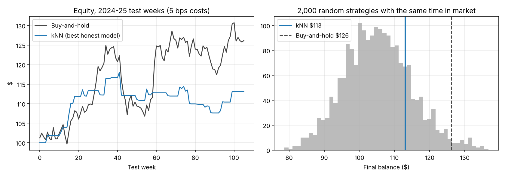

<div align="center">

# Can ML Beat Buy-and-Hold?

**Backtesting 9 ML trading strategies on Coca-Cola (KO) weekly data, 2021–2025, and auditing my own backtest for look-ahead bias**


</div>

> **TL;DR:** My first version showed three models beating buy-and-hold. When I audited it, I found **look-ahead leakage**: each week was predicted from that same week's returns, which aren't known until the week is over. After fixing it (lagged features, walk-forward retraining, 5 bps trading costs), **no model beats buy-and-hold**. The best one, kNN, finishes at $113 against $126 and sits at about the 80th percentile of random strategies with the same time in market, which is within luck. The "68.9% accuracy" several models reported is exactly the score of always saying "stay in cash", because 69% of test weeks are labelled red.

<br>

## Corrected results: $100 over 106 test weeks (2024–2025)

Walk-forward: before each test week, the model is refit on every week up to the previous one. Features use only information available at the previous week's close. Costs are 5 bps per side on every switch.

| Strategy | Accuracy | Final balance | Sharpe | Max drawdown | 95% weekly VaR | Time in market | Trades | Beats % of random* |
|:--|--:|--:|--:|--:|--:|--:|--:|--:|
| *Buy-and-hold* | – | ***$126.14*** | *0.89* | *-14.5%* | *2.7%* | *100%* | *1* | – |
| kNN (k=5) | 45.3% | $113.08 | 0.85 | -8.8% | 1.0% | 31% | 40 | 80% |
| Decision tree (Gini) | 46.2% | $106.29 | 0.42 | -10.2% | 1.7% | 36% | 50 | 51% |
| Random forest (N=10, d=5) | 57.5% | $103.86 | 0.30 | -9.6% | 0.7% | 19% | 34 | 56% |
| Gaussian Naive Bayes | 67.0% | $103.61 | 0.53 | -2.5% | 0.0% | 6% | 6 | 73% |
| Decision tree (entropy) | 54.7% | $99.94 | 0.04 | -8.6% | 1.6% | 33% | 52 | 28% |
| Logistic regression, LDA, QDA, linear SVM | 68.9% | $100.00 | – | 0% | 0% | 0% | 0 | never invested |

\*Share of 2,000 random strategies, holding for the same number of weeks, that finished below the model. 95% would be the usual bar for "not luck"; none come close.



### What changed and why

| Original notebooks | Corrected backtest (`src/honest_backtest.py`) |
|:--|:--|
| Week *t* predicted from week *t*'s own mean return and volatility | Week *t* predicted from weeks *t-1*, *t-2* and the prior 4-week return |
| One fixed train/test split (2021–23 / 2024–25) | Walk-forward, refit before every test week |
| No trading costs | 5 bps per side per switch (`--cost-bps` to change) |
| Final balance only | Sharpe, max drawdown, VaR, exposure, trades, random benchmark |

The original leaky results are kept in the notebooks and in `results/honest_backtest.csv` (columns `Acc (leaky)` and `Final (leaky)`) for comparison.

### What I learned

- **Audit the timeline before the model.** The leak was in how features lined up with labels, not in any model's code.
- **Compare accuracy with the base rate.** 68.9% looked respectable until I checked that 69% of test weeks were "red". Four models learned to say "stay in cash" every week.
- **A win needs a null distribution.** A random strategy with the same exposure beats kNN 20% of the time, so a single backtest window can't separate skill from luck.
- **The labels are noisy.** The weekly green/red labels from the course assignment correlate only 0.12 with that week's actual return; some +3–4% weeks are labelled red. A cleaner target would be the sign of the next week's return, net of costs.

## What's inside

| File | Technique |
|:--|:--|
| `src/honest_backtest.py` | Leakage-free walk-forward backtest with costs, risk metrics and random benchmark |
| `tests/test_no_leakage.py` | Asserts that every feature uses only past weeks, and that costs are applied |
| `01`–`03` | Label engineering and the label-following strategy (the "perfect foresight" upper bound) |
| `04_knn` · `05_logistic_regression` | kNN with k tuning; logistic regression |
| `06_polynomial_window_models` | Rolling-window polynomial regression (W = 5–12, d = 1–3) |
| `07_linear_separability` | Hand-drawn linear decision boundary on reduced data |
| `08`–`10` | Gaussian and Student-t Naive Bayes, LDA vs QDA |
| `11`–`12` | Decision tree (entropy vs Gini) and random forest grid search |
| `13_strategy_hamming_distance` | Distance between each strategy's decisions and the true labels |
| `14_svm` · `15_kmeans_regimes` | Linear, RBF and polynomial SVM; k-means market regimes |

> **Note:** notebooks `04`–`14` are the original course versions and use same-week features. Use `src/honest_backtest.py` for the results above.

Data: `KO_weekly_return_*.csv`, built with `utils/` from Yahoo Finance.

## Run it

```bash
pip install -r requirements.txt
python src/honest_backtest.py              # prints the table above, writes results/ and figures/
python src/honest_backtest.py --cost-bps 10
pytest -q                                  # leakage and cost checks
```

## What I'd do next

- A multi-asset universe (sector ETFs or the Dow 30) so results don't hinge on one stock
- Replace the hand-drawn labels with next-week return net of costs
- Rolling-window (not only expanding) retraining, and a bootstrap confidence interval on Sharpe

<br>

<sub>Started in Boston University MET CS 577 (Data Science with Python), Spring 2026; the leakage audit and corrected backtest were added afterwards. Data helper scripts in <code>utils/</code> were provided by the course.</sub>
